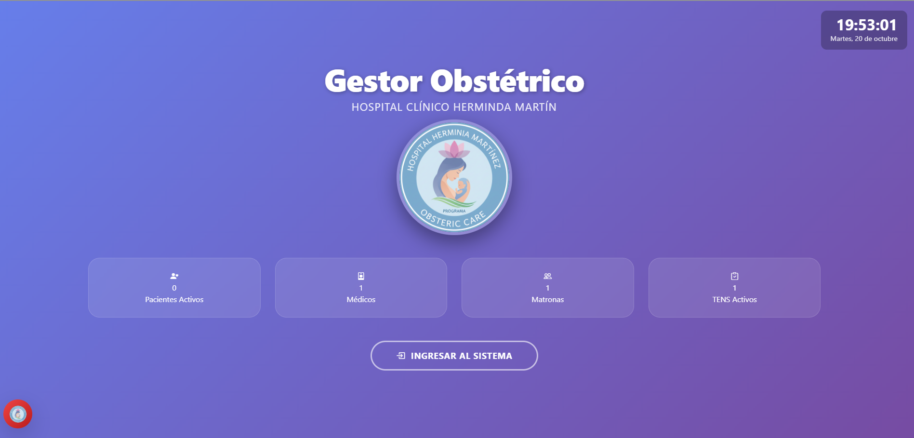
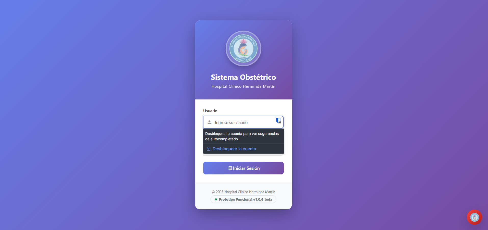
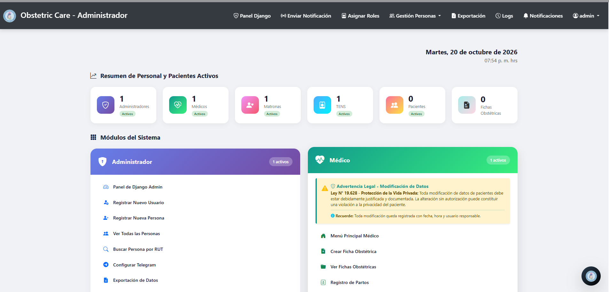
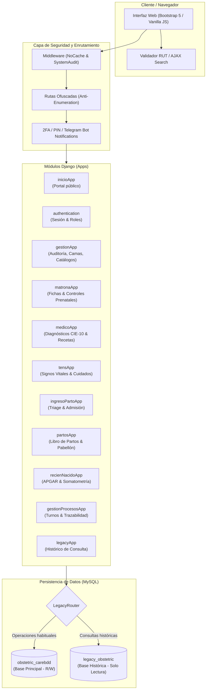

# 🏥 OB Care — Sistema de Gestión Obstétrica

[](https://www.python.org/)
[](https://www.djangoproject.com/)
[](https://www.mysql.com/)
[](https://getbootstrap.com/)
[](https://core.telegram.org/bots)
[](https://docs.pytest.org/)

**OB Care** es una plataforma integral de gestión clínica y administrativa diseñada para unidades de maternidad, preparto, pabellón obstétrico y neonatología. Adaptada a la normativa sanitaria y estándares chilenos (validación de RUT, cálculo obstétrico de IMC, registro del Libro de Partos MINSAL, test de APGAR y somatometría neonatal), la plataforma unifica el flujo de trabajo interdisciplinario entre matronas, médicos especialistas, técnicos en enfermería (TENS) y administradores.

---

## 📑 Tabla de Contenidos

1. [Características Principales](#-características-principales)
2. [Capturas de Pantalla e Interfaz](#-capturas-de-pantalla-e-interfaz)
3. [Arquitectura del Sistema](#-arquitectura-del-sistema)
4. [Roles de Usuario y Accesos](#-roles-de-usuario-y-accesos)
5. [Estructura del Proyecto](#-estructura-del-proyecto)
6. [Requisitos Previos](#-requisitos-previos)
7. [Instalación y Puesta en Marcha](#-instalación-y-puesta-en-marcha)
8. [Configuración de Bases de Datos](#-configuración-de-bases-de-datos)
9. [Comandos y Scripts de Utilidad](#-comandos-y-scripts-de-utilidad)
10. [Seguridad y Auditoría](#-seguridad-y-auditoría)
11. [Pruebas y Control de Calidad](#-pruebas-y-control-de-calidad)
12. [Manuales de Usuario y Recursos](#-manuales-de-usuario-y-recursos)
13. [Créditos y Licencia](#-créditos-y-licencia)

---

## ✨ Características Principales

- **Gestión Clínica Especializada por Rol:** Dashboards independientes y especializados para Matronería, Médicos Obstétras, TENS y Administración.
- **Ficha Obstétrica Integral:** Control prenatal, edad gestacional por FUR/ECO, cálculo automático de IMC gestacional, clasificación de riesgo y antecedentes mórbidos.
- **Admisión y Triage de Parto:** Flujo de ingreso de urgencia obstétrica, control de contracciones, borramiento, dilatación y membranas.
- **Registro Quirúrgico y Libro de Partos Digital:** Parto vaginal, cesáreas y fórceps con registro de equipo clínico (cirujano, matrona, anestesista, arsenalera) y exportación oficial a Excel (`.xlsx`) y PDF.
- **Atención Inmediata del Recién Nacido:** Valoración de APGAR (al minuto y a los 5 minutos), somatometría completa (peso, talla, perímetro cefálico), apego precoz piel a piel y profilaxis neonatal.
- **Monitoreo de Signos Vitales TENS:** Registro periódico con semaforización de alertas (PA, FC, FR, Temperatura, Saturación de O₂).
- **Gestión Hospitalaria:** Maestro de pacientes y personal, control de disponibilidad y asignación de salas y camas.
- **Notificaciones y Alertas en Tiempo Real:** Integración con **Telegram Bot** para alertas clínicas críticas a personal de turno y correo transaccional SMTP.
- **Doble Base de Datos (Operacional + Histórica):** Capacidad de consultar registros históricos legados (`legacy_obstetric`) de forma aislada y segura mediante *Database Routers* de solo lectura.
- **Validaciones Sanitarias Locales:** Validador algorítmico de RUT chileno (módulo 11) en backend (Python) y frontend (JavaScript) reactivo.

---

## 📸 Capturas de Pantalla e Interfaz

### 🏠 Portal de Inicio
Portal público con métricas en tiempo real de pacientes y personal de turno en el **Hospital Clínico Herminda Martín**:


### 🔐 Inicio de Sesión y Autenticación
Módulo de acceso seguro con redirección contextual según el rol asignado (Administrador, Médico, Matrona o TENS):
<p align="center">
  
</p>

### 👑 Panel de Control del Administrador
Dashboard del rol administrativo con métricas activas, accesos a registros clínicos, catálogos, auditoría y cumplimiento de la **Ley Nº 19.628** (Protección de la Vida Privada):


---

## 🏛️ Arquitectura del Sistema



---

## 👥 Roles de Usuario y Accesos

El sistema cuenta con control de acceso basado en roles (**RBAC**). Cada perfil redirige a su panel exclusivo:

| Rol | Responsabilidades | Ruta por Defecto |
|---|---|---|
| 👑 **Administrador** | Gestión de usuarios, asignación de roles, auditoría global del sistema, catálogos y gestión de camas. | `/w3x9k7m2/` |
| 🩺 **Médico** | Diagnósticos clínicos, indicaciones farmacológicas, recetas y evoluciones médicas. | `/p5n8j4q1/` |
| 🌸 **Matrona** | Ingreso de fichas obstétricas, control preparto, atención del parto y recién nacido, emisión del Libro de Partos. | `/r2t6v9h3/` |
| 🩹 **TENS** | Control periódico de signos vitales, administración de fármacos por indicación y cuidados del paciente. | `/l1w5d0y8/` |
| 👤 **Paciente** | Consulta informativa de citas y estado (perfil restringido). | `/portal/` |

> 🔒 *Nota de Seguridad:* Las URLs de acceso a los dashboards y al panel administrativo (`/n5p8r3t7/`) cuentan con nombres protegidos para mitigar ataques de escaneo y enumeración.

---

## 📂 Estructura del Proyecto

```text
OB_Care_Sistema_de_Gestion_Obstetrica/
├── obstetric_care/          # Configuración global Django (settings, urls, dbrouters, wsgi)
├── authentication/          # Vistas de autenticación, login, logout, PIN y 2FA
├── inicioApp/               # Landing page institucional
├── gestionApp/              # Gestión de pacientes, personal, camas, auditoría y catálogos
├── matronaApp/              # Ficha obstétrica, medicamentos y controles prenatales
├── medicoApp/               # Diagnósticos, atenciones médicas y recetas
├── tensApp/                 # Control de signos vitales y atenciones de enfermería
├── ingresoPartoApp/         # Admisión de urgencia, valoración y triage
├── partosApp/               # Registro de parto, personal quirúrgico y Libro de Partos
├── recienNacidoApp/         # Ficha neonatal, APGAR y somatometría
├── gestionProcesosApp/      # Turnos de personal, bot de Telegram y trazabilidad clínica
├── legacyApp/               # Integración de consulta con base de datos histórica
├── templates/               # Plantillas HTML globales y por módulo (Bootstrap 5)
├── static/                  # Archivos estáticos (CSS, JS, imágenes e iconos)
├── utilidad/                # Validadores (RUT, IMC), manuales PDF oficiales y catálogos
├── tests/                   # Suite de pruebas automatizadas (pytest)
├── docs/                    # Documentación interna (Guía de roles, flujos)
├── requirements.txt         # Dependencias Python del proyecto
├── setup_project.py         # Script de inicialización rápida
├── manage.py                # CLI de Django
└── locustfile.py            # Pruebas de estrés y rendimiento de carga
```

---

## 📋 Requisitos Previos

- **Python:** Versión `3.11` o superior recomendada.
- **MySQL / MariaDB:** Servidor MySQL 8.0+ en ejecución (por defecto `127.0.0.1:3306`).
- **Git:** Para control de versiones.
- **PowerShell / Bash:** Terminal de comandos del sistema operativo.

---

## 🚀 Instalación y Puesta en Marcha

### 1. Clonar el repositorio

```bash
git clone https://github.com/rjoserivera/OB_Care_Sistema_de_Gestion_Obstetrica.git
cd OB_Care_Sistema_de_Gestion_Obstetrica
```

### 2. Crear y activar el entorno virtual

- En **Windows (PowerShell)**:
  ```powershell
  python -m venv venv
  .\venv\Scripts\Activate.ps1
  ```
- En **Linux / macOS**:
  ```bash
  python3 -m venv venv
  source venv/bin/activate
  ```

### 3. Instalar dependencias

```bash
pip install -r requirements.txt
```

### 4. Configurar las Bases de Datos en MySQL

Accede a tu gestor de base de datos MySQL (phpMyAdmin, DBeaver o CLI) y crea las dos bases de datos requeridas:

```sql
CREATE DATABASE obstetric_carebdd CHARACTER SET utf8mb4 COLLATE utf8mb4_unicode_ci;
CREATE DATABASE legacy_obstetric CHARACTER SET utf8mb4 COLLATE utf8mb4_unicode_ci;
```

> Si deseas importar los datos históricos de demostración, ejecuta el script SQL disponible en `utilidad/legacy_obstetric (1).sql` dentro de la base de datos `legacy_obstetric`.

### 5. Configurar variables de conexión

Verifica los parámetros de conexión en [obstetric_care/settings.py](file:///c:/Users/Joseph%20Rivera/Documents/OB_Care_Sistema_de_Gestion_Obstetrica/obstetric_care/settings.py):

```python
DATABASES = {
    'default': {
        'ENGINE': 'django.db.backends.mysql',
        'NAME': 'obstetric_carebdd',
        'USER': 'root',
        'PASSWORD': 'tu_password',
        'HOST': '127.0.0.1',
        'PORT': '3306',
    },
    'legacy': {
        'ENGINE': 'django.db.backends.mysql',
        'NAME': 'legacy_obstetric',
        'USER': 'root',
        'PASSWORD': 'tu_password',
        'HOST': '127.0.0.1',
        'PORT': '3306',
    }
}
```

### 6. Ejecutar migraciones e inicializar el sistema

```bash
python manage.py makemigrations
python manage.py migrate
python setup_project.py
```

`setup_project.py` creará de manera atómica:
1. Grupos/Roles del sistema (`Administrador`, `Médico`, `Matrona`, `TENS`).
2. Usuarios base iniciales con sus perfiles vinculados.
3. Catálogos médicos iniciales (medicamentos, vías de administración y consultorios).

### 7. Iniciar el servidor de desarrollo

```bash
python manage.py runserver 0.0.0.0:8000
```
O ejecutando el script PowerShell:
```powershell
.\start_server.ps1
```

Accede desde tu navegador a `http://localhost:8000`.

---

## 🔑 Credenciales Iniciales de Prueba

| Usuario | Contraseña | Rol Asignado |
|---|---|---|
| `admin` | `admin123` | Administrador (Superuser) |
| `matrona` | `matrona123` | Matrona |
| `medico` | `medico123` | Médico Obstetra |
| `tens` | `tens123` | Técnico en Enfermería (TENS) |

*(Adicionalmente, el comando `python manage.py crear_usuarios_iniciales` permite crear al administrador `Bocchi` con clave `Bocchi` y pacientes de prueba).*

---

## 🛠️ Comandos y Scripts de Utilidad

El proyecto incluye comandos de gestión especializados en `python manage.py`:

| Comando | Descripción |
|---|---|
| `python manage.py gestionar_usuarios_roles` | **Menú interactivo completo** para crear usuarios, asignar roles, cambiar contraseñas y listar personal. |
| `python manage.py crear_grupos_sistema` | Inicializa los grupos oficiales del sistema sin duplicados. |
| `python manage.py crear_usuarios_realistas` | Genera usuarios de prueba con RUT válidos y nombres reales. |
| `python manage.py generar_datos_demo --cantidad 50` | Puebla fichas, ingresos de parto y atenciones para demostraciones. |
| `python manage.py poblar_catalogos_parto` | Carga los catálogos del proceso quirúrgico y tipos de parto. |
| `python manage.py probar_exportacion` | Valida la generación y consistencia del Libro de Partos en formato Excel. |
| `python manage.py telegram_bot` | Inicia el servicio de escucha y despacho de notificaciones vía Telegram. |

### Scripts por Lote (`.bat` y `.ps1`)

- `run_full_demo.bat`: Activa el entorno y carga 100 registros de prueba.
- `reiniciar_servidor.bat`: Detiene y levanta el servidor web de forma limpia.
- `limpiar_grupos.bat`: Remueve grupos redundantes y sincroniza permisos.
- `start_server.ps1`: Inicializa el servidor y las alertas de Telegram en Windows.

---

## 🛡️ Seguridad y Auditoría

1. **Auditoría Completa de Peticiones (`SystemAuditMiddleware`):** Registro de cada acción clínica con usuario, timestamp, IP, vista accedida y cambios realizados.
2. **Protección de Caché Sensible (`NoCacheMiddleware`):** Impide que navegadores almacenen en caché historiales clínicos y fichas de pacientes.
3. **Ofuscación de Rutas Sensibles:** Rutas del panel administrativo y dashboards personalizadas para evitar detección pasiva de endpoints Django estándar.
4. **Validación de Identidad Sanitaria:** Prevención de suplantación y control de duplicidad mediante validación estricta de RUT chileno.
5. **Autenticación en Dos Pasos (2FA):** Soporte de verificación mediante PIN y token de Telegram.

---

## 🧪 Pruebas y Control de Calidad

### Pruebas Unitarias y de Integración con Pytest

El proyecto cuenta con un plan de pruebas en `tests/test_plan_completo.py` que evalúa:
- **Funcionalidades Core:** Validación de RUT, cálculo de IMC, formularios de pacientes.
- **Seguridad:** Resistencia ante inyección SQL (SQLi) y Cross-Site Scripting (XSS).
- **Consistencia de Datos:** Integridad referencial y cascadas de eliminación.

Para ejecutar los tests:
```bash
pytest
```
O con reporte detallado y cobertura:
```bash
pytest -v --cov=.
```

### Pruebas de Carga con Locust

Para medir los tiempos de respuesta del portal y las búsquedas AJAX:
```bash
locust -f locustfile.py --host http://localhost:8000
```
Luego abre `http://localhost:8089` para iniciar la simulación de usuarios concurrentes.

---

## 📚 Manuales de Usuario y Recursos

En la carpeta [`utilidad/`](file:///c:/Users/Joseph%20Rivera/Documents/OB_Care_Sistema_de_Gestion_Obstetrica/utilidad) se encuentran disponibles los manuales operativos en formato PDF:

- 📕 [Manual de Usuario - Administrador](file:///c:/Users/Joseph%20Rivera/Documents/OB_Care_Sistema_de_Gestion_Obstetrica/utilidad/Manual_Usuario_Administrador.pdf)
- 📗 [Manual de Usuario - Médico](file:///c:/Users/Joseph%20Rivera/Documents/OB_Care_Sistema_de_Gestion_Obstetrica/utilidad/Manual_Usuario_Medico.pdf)
- 📘 [Manual de Usuario - Matrona](file:///c:/Users/Joseph%20Rivera/Documents/OB_Care_Sistema_de_Gestion_Obstetrica/utilidad/Manual_Usuario_Matrona.pdf)
- 📙 [Manual de Usuario - TENS](file:///c:/Users/Joseph%20Rivera/Documents/OB_Care_Sistema_de_Gestion_Obstetrica/utilidad/Manual_Usuario_TENS.pdf)
- 📑 [Guía Detallada de Usuarios y Roles](file:///c:/Users/Joseph%20Rivera/Documents/OB_Care_Sistema_de_Gestion_Obstetrica/docs/GUIA_USUARIOS_ROLES.md)

---

## 👨‍💻 Créditos y Licencia

Desarrollado como proyecto para el área de Informática Biomédica / Analista Programador.

- **Repositorio Oficial:** [OB_Care_Sistema_de_Gestion_Obstetrica](https://github.com/rjoserivera/OB_Care_Sistema_de_Gestion_Obstetrica)
- **Autor / Mantenedor:** José Rivera ([@rjoserivera](https://github.com/rjoserivera))
- **Licencia:** Uso académico y demostrativo. Todos los derechos reservados.
